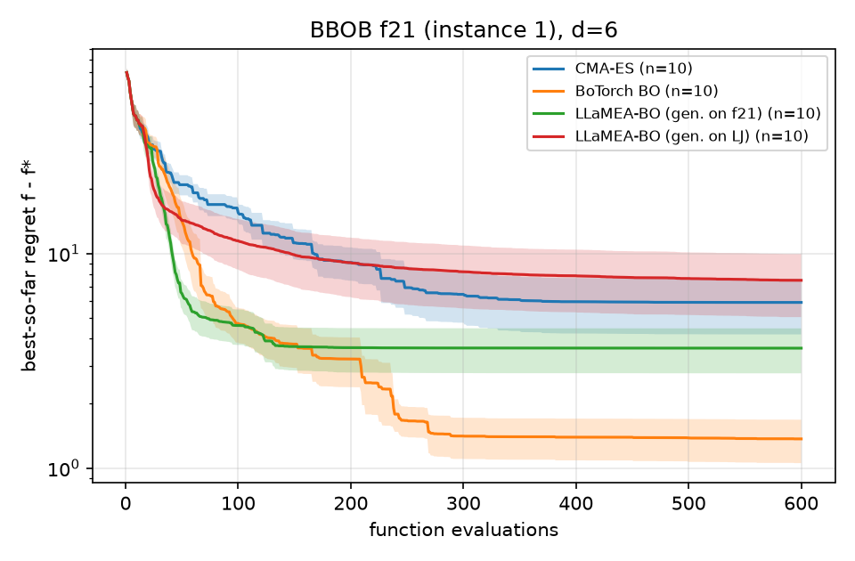
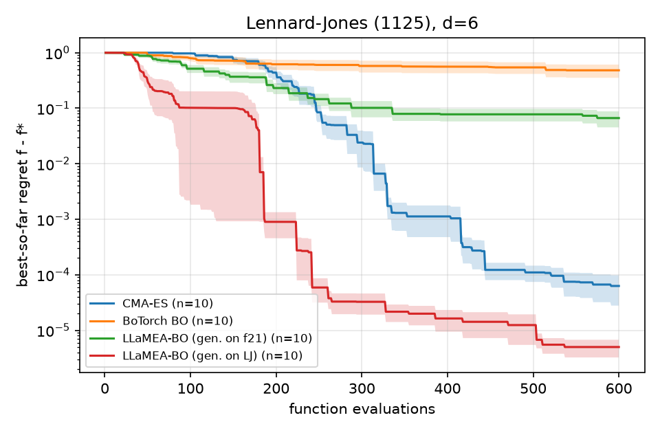
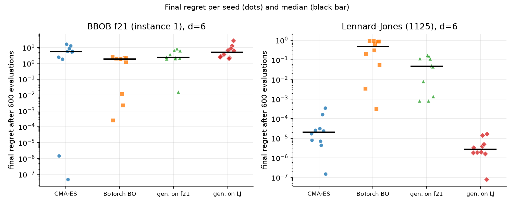
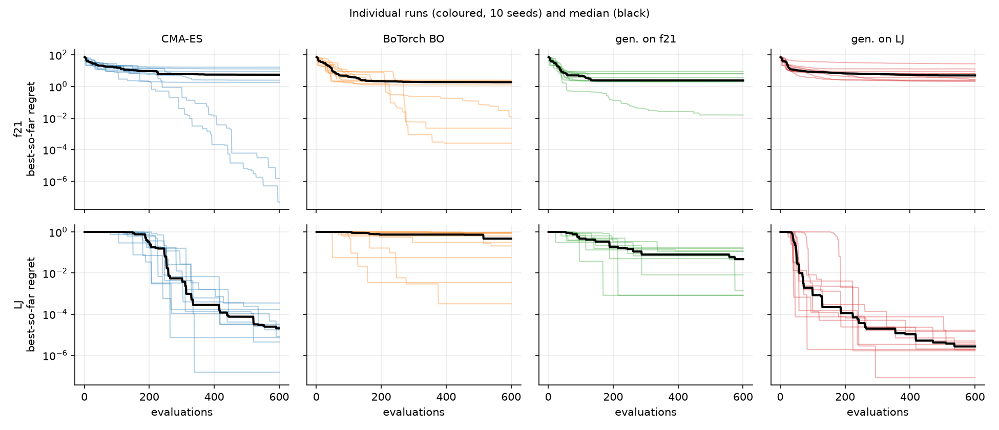
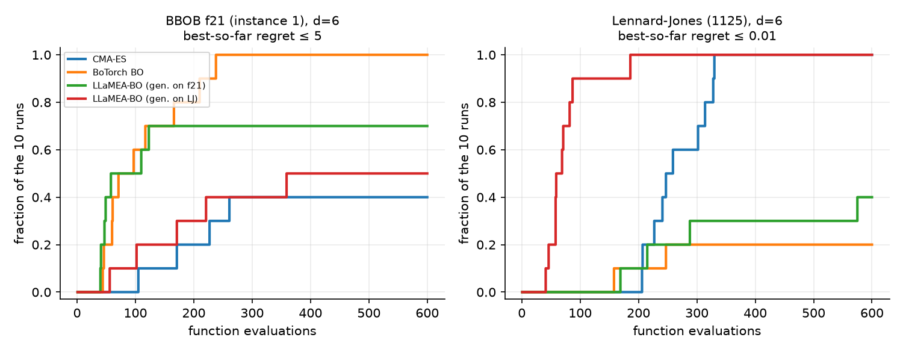
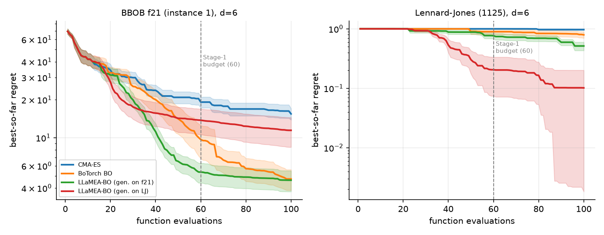
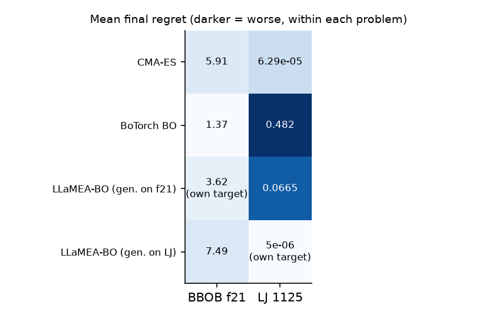
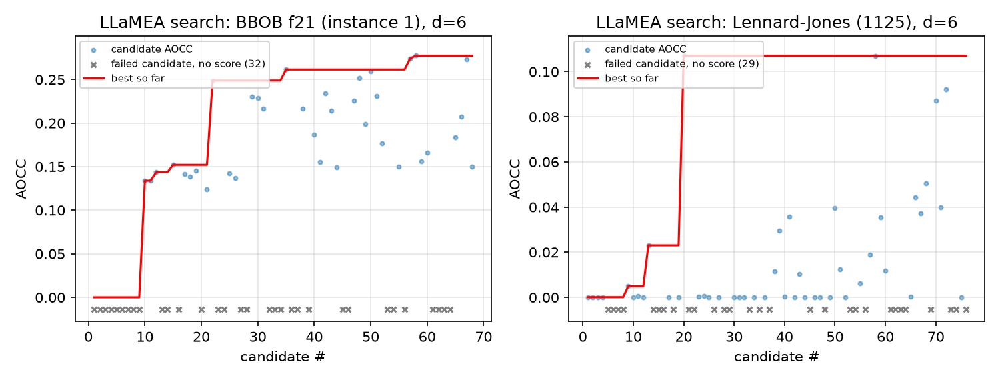
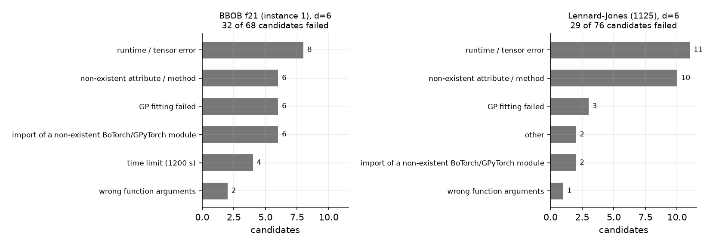
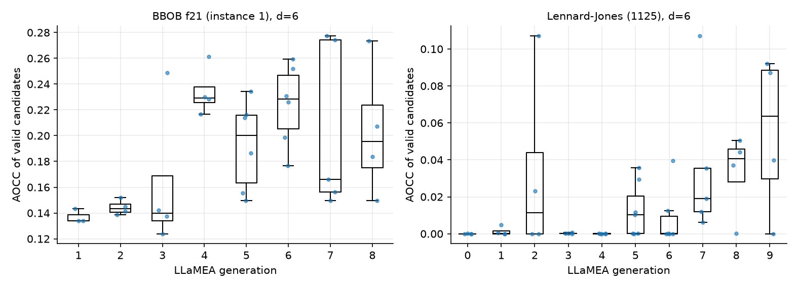

# LLaMEA-generated Bayesian Optimization — generation & generalization (Group 6)

Targets (d = 6, seeds 60–69 = 10·6 + r):
* **BBOB f21** (Gallagher 101 peaks), instance 1
* **Practical problem 1125** — Lennard-Jones potential (`Practical_Problems`); the d = 6 instance behaves like a
  two-atom cluster: global minimum **−1.0**, the rest of the box is an almost flat plateau (|f| ≲ 1e-8).
  (`problem.optimum.y` reports 0.0, which is a placeholder; regret uses f* = −1.)

## 1. Environment
```bash
uv sync --locked                         # Python 3.13, CPU-only PyTorch
```
`uv` reads `.python-version`, `pyproject.toml`, and `uv.lock` and creates a local `.venv`.
`requirements.txt` records the exact packages used for the original runs. The uv environment also includes Jupyter and
`python-dotenv` for the notebook and small examples retained from `main`.
LLaMEA needs SWIG only for some of its optional features; `pip install llamea` worked here without it.
The code runs on CPU only; no GPU is used or required.

## 2. LLM provider
Google AI Studio free tier, model `gemini-3.1-flash-lite` (set in `config/experiment.json`).
```bash
cp .env.example .env     # then put your key in .env:  GOOGLE_API_KEY=...
```
`boa/llm.py` wraps LLaMEA's `Gemini_LLM` with patient retries (exponential back-off on 429/5xx), because the free tier
returns frequent `503 UNAVAILABLE`; the built-in wrapper gives up after 5 short retries, which wasted candidates.
Other free providers: swap the class in `run_llamea.py`.

## 3. Running
```bash
# Stage 1: one LLaMEA search per target (budget 100 candidates, 10 runs x 60 evaluations each, ranked by AOCC).
# NOTE: our reported searches were stopped by the Gemini free-tier daily quota at 68 (f21) / 76 (LJ) candidates.
uv run --locked python run_llamea.py bbob_f21 --run-tag run2   # also: --llm gemini|cerebras|mistral
uv run --locked python run_llamea.py lj1125   --run-tag run2
#   logs: results/llamea_logs/exp-*/{log.jsonl,conversationlog.jsonl,code/}; best code: results/best_<target>_<tag>.py
# Stage 2: 600 evaluations, 10 seeds, all methods on both problems (resumable; one .npy per run)
uv run --locked python run_benchmark.py --gen bbob_f21=results/best_bbob_f21_run2.py --gen lj1125=results/best_lj1125_run2.py --procs 6
uv run --locked python make_plots.py     # results/figures/*.png and summary.md
```

## 4. Configuration (`config/experiment.json`)
| key | value |
|---|---|
| seeds | 60…69 (same for LLaMEA evaluation and stage 2, all methods) |
| n_init | 12 scrambled-Sobol points (seeded), identical for all methods, counted in the budget |
| stage-1 budget / stage-2 budget | 60 / 600 evaluations per run |
| LLaMEA | 100 candidates, (4 parents, 8 offspring), elitism, 5 workers, gemini-3.1-flash-lite |
| candidate time limit | 1200 s per candidate (10 runs); exceeding it = failed candidate (score −inf + feedback) |
| AOCC regret bounds | f21: [0.1, 100]; LJ: [1e-6, 1] |

Prompts: `prompts/base_task.txt` (shared; adapted from the instructors' sample), `prompts/hint_<target>.txt`
(landscape hint appended per target). Edit those files to change the prompting; evolutionary hyperparameters are in the config.

## 5. Metric and deviations from the plain protocol (documented design choices)
* **AOCC** = 1 − mean over the 60 evaluations of the min–max normalised log10 *regret* of the best-so-far value
  (clipped to the bounds above; evaluations not made count as worst). Averaged over the 10 seeds. Higher is better, 1 is
  unreachable (it needs the optimum at evaluation 1). Bounds are our own choice, so absolute values are not comparable
  with the LLaMEA-BO paper; they were chosen so a plateau-only run scores 0 and a good run is well inside the range.
* **Initial design**: all methods start from the same seeded Sobol design (12 points). CMA-ES evaluates it and starts
  from its best point with σ0 = 2; BoTorch BO and generated algorithms receive it as `initial_points`.
* **Time limit** enforced inside the evaluator (see above). LLaMEA's own `eval_timeout` is only a backstop, because an
  expired LLaMEA timeout crashes the whole run (observed; `results/llamea_logs/archive_run1_crashed/`).
* The prompts contain a short landscape hint per target (documented in `prompts/`).
* BoTorch baseline (`baselines/botorch_bo.py`): GP with ARD Matérn-5/2, input normalisation, outcome standardisation,
  LogEI. Instructors' exact BO settings were not yet specified — change the constructor arguments when they are.
* The 10 evaluation seeds are the same ones LLaMEA selected on, so stage-2 results of the generated algorithm on its own
  target are optimistic (seed overfitting); noted in the analysis.

## 6. Hardware used
Intel Core i3-1220P (12 threads), 62 GB RAM, Linux 6.12, CPU only; evaluation single-threaded per worker
(`OMP_NUM_THREADS=1`, `torch.set_num_threads(1)`). The machine also hosted unrelated services, so wall-clock times are noisy.

## 7. Results (figures: `results/figures/`, table: `results/figures/summary.md`)

Stage 2: 600 evaluations, seeds 60–69, shared 12-point Sobol start. Final best-so-far regret, mean ± standard error over 10 seeds (lower is better):

| problem | CMA-ES | BoTorch BO | LLaMEA-BO (gen. on f21) | LLaMEA-BO (gen. on LJ) |
|---|---|---|---|---|
| BBOB f21 (d=6) | 5.91 ± 1.7 | **1.37 ± 0.31** | 3.62 ± 0.86 | 7.49 ± 2.4 |
| LJ 1125 (d=6, regret = f + 1) | 6.3e-5 ± 3.5e-5 | 0.48 ± 0.13 | 6.6e-2 ± 2.1e-2 | **5.0e-6 ± 1.8e-6** |

Convergence curves (mean ± standard error over 10 seeds, log y):




Means hide a lot on these two problems (both are "found the peak / did not find it"), so the figures below show every seed:





Observations:
- **LJ:** the algorithm generated on LJ is best: mean final regret 5.0e-6 vs 6.3e-5 for CMA-ES (about 12× lower; by median 2.7e-6 vs 2.0e-5, about 7×). It is also much faster: all 10 runs reach regret ≤ 0.01 (the well), 9 of them within 90 evaluations (median about 60); CMA-ES reaches it in all 10 runs but only after 206–330 evaluations. Plain BoTorch BO reaches it in only 2/10 runs, because the objective is flat almost everywhere and the GP has nothing to model; the f21-generated algorithm reaches it in 4/10 runs. The slow late step in the mean curve (around evaluation 185) is a single slow seed, not the typical behaviour.
- **f21:** plain BoTorch BO is best by mean (1.37) and median (1.84; generated-on-f21 median 2.37, CMA-ES 5.5, generated-on-LJ 5.0). The f21 landscape is bimodal in outcome: in 2/10 CMA-ES runs and 3/10 BoTorch runs the best peak was found (regret < 0.1), against 1/10 for the f21-generated algorithm and 0/10 for the LJ-generated one; all other runs stay at regret 1–30. Means are therefore sensitive to a few seeds. The f21-generated algorithm is clearly fastest in the first 50–100 evaluations (the setting it was selected on) but then stagnates, while BoTorch BO keeps improving.
- Specialisation is visible: each generated algorithm is better on its own target than on the other one. On LJ the specialised algorithm beats both baselines; on f21 the generated algorithm beats CMA-ES but not the BoTorch baseline, so the LLM search did not beat a standard BO there at 600 evaluations.


*First 100 evaluations (Stage-1 selection used 60): the f21-generated algorithm leads there, but the lead disappears later. On LJ the LJ-generated algorithm leads from about evaluation 30 on.*


*Mean final regret per method and problem (darker = worse within a problem). The off-diagonal cells show the transfer of each generated algorithm to the other problem.*

LLaMEA search progress (Stage 1): best AOCC so far per candidate, failed candidates (no score) marked, failure causes, and AOCC per generation.





Figures are produced by `make_plots.py` (convergence, summary table, search curves) and `make_extra_plots.py` (all others) from the stored raw results.

Search statistics (Gemini free tier, `gemini-3.1-flash-lite`): the daily quota (500 requests) stopped both searches early, at 68 (f21) and 76 (LJ) logged candidates. The assignment sets 100 as a maximum ("a maximum of 100 candidate algorithms"), so this is within the rules, but the best candidates are the best of fewer than 100 and a larger search might have found better ones. Best 60-evaluation AOCC: f21 0.277 (generation 7; plain BoTorch reference 0.223), LJ 0.107 (generation 2; reference 0.004). AOCC bounds are our own choice (f21 regret [0.1, 100]; LJ regret [1e-6, 1]), so values are not comparable to published numbers. Four f21 candidates hit the 20-minute candidate time limit (scored −inf). In `llamea_search_convergence.png`, grey crosses mark candidates that failed and have no score (f21: 32 of 68, LJ: 29 of 76; mostly code written for BoTorch/GPyTorch APIs that do not exist in the installed versions, plus failed model fits and timeouts); the red best-so-far line starts at 0 until the first valid candidate.

Provider history (all free-only, logs archived in `results/llamea_logs/archive_*`): a first Gemini run crashed when a candidate exceeded LLaMEA's own timeout (fixed by an in-evaluator time limit, then restarted as run2); Cerebras (gpt-oss-120b, Qwen) was abandoned after it stopped being free; Mistral codestral produced 0 valid candidates out of 200 (100 per target, verified from `log.jsonl`; outdated BoTorch API in its code); mistral-large-4 had very low yield and was stopped. The final results use only Gemini.

## 8. Generated algorithms: component-by-component analysis and pseudocode

Analysis is based on the code (`results/best_*_run2.py`), not on the LLM's own description.

### 8.1 f21 algorithm (`results/best_bbob_f21_run2.py`)
```
X <- 12 initial points; y <- f(X)
length <- 0.5                      # half-width of trust region, normalised [0,1]^d
while evaluations < budget:
    Xn <- normalise(X); fit GP(Matern-5/2 ARD, scale kernel, Gaussian likelihood) on (Xn, y)
    best <- argmin y
    box <- [Xn[best] - length, Xn[best] + length] clipped to [0,1]^d
    x_new <- argmax_{x in box} EI(x; best_f = min y)       # 10 restarts, 128 raw samples
    y_new <- f(x_new)
    if y_new < y[best]: length <- min(1.0, 1.1*length) else length <- max(0.05, 0.9*length)
    append (x_new, y_new)
return best point
```
| component | what it is |
|---|---|
| Surrogate | exact GP, ARD Matérn-5/2, raw (unstandardised) y, inputs normalised manually; refit by marginal likelihood every iteration |
| Acquisition | analytic Expected Improvement, q=1 |
| Search region | one trust region around the incumbent, adaptive size (×1.1 / ×0.9). The description says "TuRBO-m", but the code has a single region, no multiple regions and no restarts |
| Initial design | the given shared Sobol points; no own initialisation |
| Weakness | when the region shrinks to its minimum (0.05) it can no longer leave a local basin and there is no restart, which matches the stagnation seen after about 150 evaluations |

### 8.2 LJ algorithm (`results/best_lj1125_run2.py`)
```
X <- 12 initial points; y <- f(X)
length <- 1.0                      # half-width in original units (box is [-5,5]^6)
while evaluations < budget:
    z <- log(y - min(y) + 1e-9)    # compresses the plateau/needle range; best point gets z = log(1e-9)
    fit GP (BoTorch default kernel, inputs normalised, z standardised) on (X, z)
    box <- [X[best] - length, X[best] + length] clipped to the domain
    x_new <- argmax_{x in box} qNoisyEI(x; X_baseline = X)     # 10 restarts, 256 raw samples
    y_new <- f(x_new)
    if y_new < y[best]: length <- min(2.0, 1.1*length) else length <- max(0.05, 0.8*length)
    append
return best point
```
| component | what it is |
|---|---|
| Output transform | log of the shifted objective, then standardised. Relative to the current best, so it changes every iteration |
| Surrogate | exact GP with BoTorch default kernel (Matérn-5/2 ARD), refit every iteration |
| Acquisition | qNoisyExpectedImprovement (q=1) |
| Search region | single trust region, size in original units, ×1.1 on improvement, ×0.8 otherwise (faster shrinking than the f21 algorithm) |
| Sign question | z is not negated although BoTorch maximises, so the acquisition nominally prefers worse points. We tested a variant with −z (seeds 60–62, 150 evaluations, `results/sign_check/`): final regret original 5.0e-5 / 1.9e-6 / 1.5e-4 vs. negated 9.5e-5 / 8.2e-6 / 5.9e-4. The negated variant was **not** better, so the sign does not explain the performance. Likely reasons are that the trust region plus the shrinking schedule, rather than the acquisition value, drives the local search, and that the standardised log-values of an almost flat plateau carry little signal. We did not investigate this further, so we do not claim a mechanism |

Script and raw output: `results/sign_check/`. Three seeds only, so it is anecdotal; it was run outside the main pipeline.

## 9. Generalization discussion

- **Seed overfitting.** Candidates were selected by AOCC on seeds 60–69, which are the same seeds used in Stage 2. The Stage 2 numbers of the generated algorithms on their own target are therefore optimistically biased (selection on the evaluation seeds, and a best-of-68/76 selection). The comparison against CMA-ES and BoTorch BO, which were not tuned on these seeds, favours the generated algorithms. A held-out seed set would be the fix; we did not run one.
- **Budget mismatch.** Selection used 60 evaluations, Stage 2 uses 600. The f21 algorithm is excellent at 60 and stagnates later; it is tuned for short budgets, and plain BoTorch BO overtakes it after about 100 evaluations. For the LJ algorithm the mismatch is smaller: about half of its runs (5/10) had already found the well by evaluation 60, and 9/10 by 90, so the selection signal at 60 evaluations (AOCC 0.107) was meaningful, but the final regret (about 1e-5) is decided in the later, local-refinement part that Stage 1 does not measure.
- **Cross-problem transfer.** Swapping the algorithms (green/red curves) shows that each is specialised: the f21 algorithm on LJ ends at 0.066 vs 5e-6, the LJ algorithm on f21 at 7.5 vs 3.6.
- **Landscape caveat.** LJ at d=6 is an almost flat plateau with a narrow well, not a rugged multimodal function, so success there says more about local trust-region search around the best point than about global modelling. The LJ algorithm's result should not be read as general "better BO".
- **Baselines.** The BoTorch and CMA-ES settings are our own choices (listed above); the instructors did not specify them, so rankings could change with their settings. CMA-ES uses sigma0 = 2 from the best initial point.
- **Search budget.** Searches stopped at 68/76 candidates (the limit of 100 is a maximum) because of the free-tier quota, one search per target, so there is no estimate of how much the result depends on the random search trajectory.

## 10. Repository layout
`boa/` problems, AOCC, evaluator, LLM wrapper · `baselines/` CMA-ES and BoTorch BO · `run_llamea.py` · `run_benchmark.py` ·
`make_plots.py` · `make_extra_plots.py` · `prompts/` · `config/` · `results/` (logs, raw per-run values, figures). Reused external code is credited
in file headers (pycma, BoTorch tutorials, LLaMEA, the instructors' `Practical_Problems` and sample task prompt).
